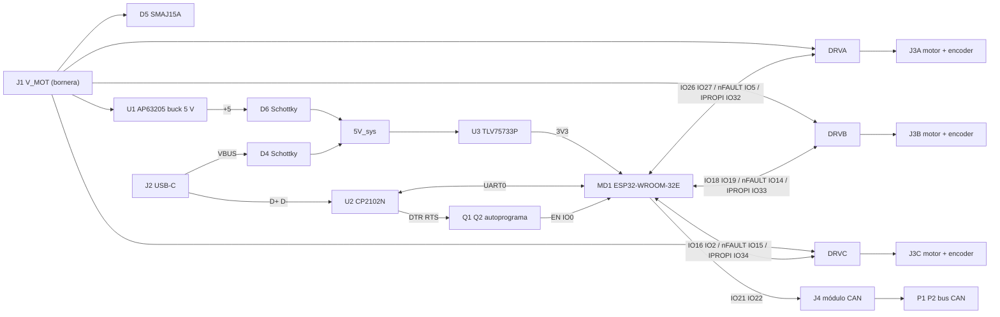
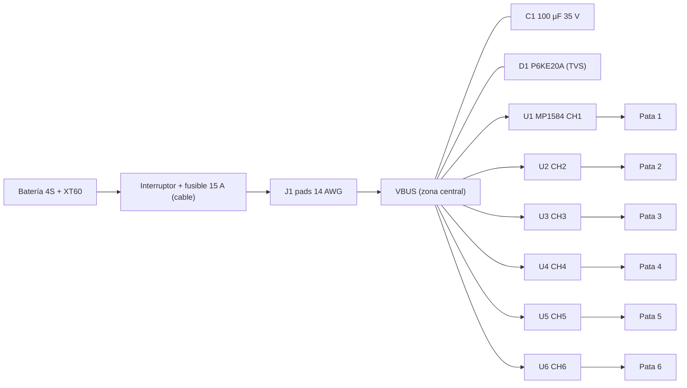

# Módulo de control de extremidad — Registro del proyecto

> [!abstract] Resumen
> Placa propia de 2 capas con un [[ESP32-WROOM-32E]] y tres drivers [[DRV8876]] para mover los tres micromotores DC con encoder de **una pata** del robot. La versión vigente es el proyecto jerárquico **`Moduloa_DRV`** (placa `MOD_DRV.PcbDoc`), que es la que está **fabricada y ensamblada**. Además de los tres drivers, tiene una fuente propia desde V_MOT (buck de 5 V + LDO de 3,3 V), USB-C reversible y un zócalo para un módulo CAN (WCMCU-230).

> [!info] Fuente de esta nota
> Las secciones 3 y 4 se sacaron el 08/11/2026 de la **netlist compilada** de `Moduloa_DRV.PrjPcb` y de la lista de sus 88 componentes, consultadas directamente en Altium. La versión anterior (`Tesis_with_3drivers`, una sola hoja; aquí se llama **Rev. A**) se resume en [[#Historial: Rev. A (Tesis_with_3drivers)]].

---

## 1. Contexto y alcance

- La placa controla **una sola extremidad**: tres motores DC N20 con encoder, uno por articulación.
- Habrá una placa igual por cada pata y un ESP maestro que las coordina: control distribuido jerárquico maestro–esclavo, comunicado por **bus CAN**.
- Objetivo declarado del proyecto: hacer una placa ESP32 desde cero con los componentes más óptimos.

> [!note] Nomenclatura acordada
> - No usar "FOC": es un algoritmo para motores trifásicos sin escobillas. Aquí hay motores DC con escobillas.
> - Hardware: **módulo de control de extremidad de tres grados de libertad** o *tarjeta controladora de tres canales para motores DC con encoder*.
> - Control: *control en cascada (posición, velocidad, corriente)* o *PID en lazo cerrado*.
> - En títulos, "micromotores DC" mejor que "N20".

---

## 2. Cronología

| Fecha | Qué se hizo | Evidencia |
|---|---|---|
| 18/08/2026 | Se crea el PCB de `Tesis_driver` (todavía sin componentes) | `History/PCB1.~(1).PcbDoc` |
| 20/08/2026 | Primera placa poblada: 54 componentes, **1 driver** | `PCB1.~(4).PcbDoc` |
| 28/08/2026 | Versión de 1 driver cerrada | `Pick Place for PCB1.csv` |
| 02/09/2026 | **Ampliación a 3 drivers** (`Tesis_with_3drivers`) | `PCB1.~(41..46)` |
| 04/09/2026 | Salidas de fabricación de la Rev. A | `Drivers.zip` |
| 07/10/2026 | Se crea el proyecto jerárquico **`Moduloa_DRV`** (hojas ESP32, DRV8876 ×3, fuente y CAN) | logs `FOC_PCB PCB ECO 7-10-2026` |
| 08–11/10/2026 | Cambios por ECO: fuente buck + LDO, conectores motor+encoder de 6 pines, CAN, botones, nueva bornera de V_MOT | `Project Logs for Moduloa_DRV/` |
| 17/10/2026 | Pick & Place de MOD_DRV | `Pick Place for MOD_DRV.csv` |
| 18/10/2026 | **DRC: 0 violaciones** y Gerbers | `Design Rule Check - MOD_DRV.drc`, `Gerber.zip` |
| 20/10/2026 | NC Drill y paquete final | `Nuevo.zip` |
| 06/11/2026 | Bring-up de la placa ensamblada: USB, grabación, autoprograma y arranque OK | proyecto PlatformIO `Prueba_placa_MOD_DRV` |
| 07/11/2026 | Pruebas de CAN con WCMCU-230 | ver [[prueba-modulos-can-esp32-wcmcu230]] |
| 08/11/2026 | Prueba de conexiones ESP32 ↔ DRV8876 sin motores (fase 1): 0 fallas | proyecto PlatformIO `Prueba_drivers_MOD_DRV` |
| 08/11/2026 | Diseño de la **placa de alimentación PCBicho** (6× MP1584, KiCad), de la v1.0 a la v1.3; Gerbers listos | `PWR_MP1584x6/v1.3/`, ver [[#11. Placa de alimentación PCBicho (6× MP1584)]] |

---

## 3. Arquitectura

**Hojas del esquemático (jerárquico):**

| Hoja | Contenido |
|---|---|
| `MOD_DRV.SchDoc` | Hoja superior: une las demás |
| `ESP32_module.SchDoc` | ESP32, CP2102N, USB-C, autoprograma, botones, conector de programación |
| `DRV8876.SchDoc` | Un canal de motor; se instancia 3 veces (DRV_1, DRV_2, DRV_3 → sufijos A, B, C) |
| `PowerSupply.SchDoc` | Entrada de V_MOT, buck de 5 V, LDO de 3,3 V, LED |
| `CAN.SchDoc` | Zócalo del módulo CAN y conectores del bus |

**Dominios de alimentación:**

- **V_MOT:** entra por la bornera J1 y alimenta los tres drivers y el buck.
- **5V_sys:** OR con diodos Schottky entre el USB (VBUS, por D4) y el buck (+5, por D6). La placa enciende **con USB o con V_MOT**.
- **3V3:** sale del LDO U3 desde 5V_sys y alimenta ESP32, CP2102N, lógica de los drivers, encoders y módulo CAN.

---

## 4. Diseño electrónico

### 4.1 Microcontrolador

- **MD1:** ESP32-WROOM-32E (`356-ESP32WRM32E132PH`, huella de 4 MB). En la placa ensamblada se leyó un ESP32-D0WD-V3 con flash de 4 MB.
- Desacoplo de 3V3: C5 y C6 (47 µF), C11 (4,7 µF), C25 (0,1 µF).
- **Reset:** EN con pull-up R3 (10 kΩ) y C13 (4,7 µF) a GND. SW1 lleva EN a GND por R6 (470 Ω).
- **Boot:** IO0 con pull-up R5 (10 kΩ). SW2 lleva IO0 a GND por R7 (470 Ω).
- SW1 y SW2: TE 1977223-1.
- Sin usar: IO12, SENSOR_VP (IO36) y SENSOR_VN (IO39).

**Asignación completa de GPIO:**

| GPIO | Función | Notas |
|---|---|---|
| IO0 | Botón BOOT / autoprograma | Pin de arranque |
| IO1 / IO3 | U0TX / U0RX → CP2102N y P3 | |
| IO2 | DRVC IN2 | Pin de arranque; el DRV8876 tiene pull-down interno |
| IO4 | J3C pin 4 (encoder C) | |
| IO5 | DRVA nFAULT (pull-up R4A) | |
| IO13 | J3C pin 6 (encoder C) | |
| IO14 | DRVB nFAULT (pull-up R4B) | |
| IO15 | DRVC nFAULT (pull-up R4C) | Pin de arranque; el pull-up lo deja en su valor por defecto |
| IO16 | DRVC IN1 | |
| IO17 | J3B pin 6 (encoder B) | |
| IO18 | DRVB IN1 | |
| IO19 | DRVB IN2 | |
| IO21 | J4 pin 3 → CTX del módulo CAN | |
| IO22 | J4 pin 4 → CRX del módulo CAN | |
| IO23 | J3B pin 4 (encoder B) | |
| IO25 | J3A pin 6 (encoder A) | |
| IO26 | DRVA IN1 | |
| IO27 | DRVA IN2 | |
| IO32 | DRVA IPROPI (R1A) | ADC1 |
| IO33 | DRVB IPROPI (R1B) | ADC1 |
| IO34 | DRVC IPROPI (R1C) | ADC1, solo entrada |
| IO35 | J3A pin 4 (encoder A) | Solo entrada, sin pull-up interno |

### 4.2 USB y programación

- **J2:** USB-C Same Sky UJ20-C-H-G-SMT-2A-P16-TR (16 pines). **D+ en A6 y B6, D− en A7 y B7**: funciona con el cable en las dos orientaciones. A1_B12, B1_A12 y la carcasa van a GND.
- R15 y R16 (5,1 kΩ) en CC1 y CC2.
- **D3:** TVS CDSOT23-SRV05-4 sobre D+, D− y VBUS. VBUS con C9 (100 nF) y C10 (4,7 µF).
- **U2:** [[CP2102N]] (QFN-28). VDD y VREGIN a 3V3. Detección de VBUS con divisor R13 (22,1 kΩ) / R14 (47,5 kΩ). RSTb con R8 (1 kΩ) a 3V3.
- **P3:** conector de programación de 4 pines (2,54 mm): 1 GND, 2 U0RX, 3 U0TX, 4 3V3.
- **Autoprograma** con Q1 y Q2 (MMBTH10LT3G, NPN). Q1: base ← DTR por R9 (10 kΩ), emisor a RTS, colector a EN. Q2: base ← RTS por R10 (10 kΩ), emisor a DTR, colector a IO0.

| DTR | RTS | EN | IO0 |
|:-:|:-:|:-:|:-:|
| 0 | 0 | 1 | 1 |
| 0 | 1 | 1 | 0 |
| 1 | 0 | 0 | 1 |
| 1 | 1 | 1 | 1 |

### 4.3 Alimentación

| Bloque | Componentes |
|---|---|
| Entrada V_MOT | J1: bornera Würth 691214110002 (2 vías, 3,5 mm). D5: TVS SMAJ15A a GND |
| Bulk de V_MOT | C27 (220 µF 35 V híbrido, Panasonic EEH-ZA1V221P), C30 (0,1 µF) y 9 × 4,7 µF 35 V (C7, C8, C12, C14–C18, C20) |
| Buck 5 V | U1: AP63205WU-7 (5 V fijo, 2 A). EN ← V_MOT por R17 (100 kΩ). C23 (0,1 µF) de bootstrap. L1: SRP4020TA4R7M (4,7 µH). Salida +5 con C31 y C32 (47 µF) |
| OR de 5 V | D4 (VBUS → 5V_sys) y D6 (+5 → 5V_sys), ambos MBR120VLSFT1G. C21 y C22 (4,7 µF) en 5V_sys |
| LDO 3,3 V | U3: TLV75733PDBVR (1 A, SOT-23-5), EN unido a la entrada. C19 y C24 (4,7 µF) a la salida |
| Indicadores | D1 + R11 (1,6 kΩ, 2010): LED de V_MOT. D2 + R12 (470 Ω): LED de 3V3. Ambos SM0805YCL amarillos |

> [!tip] Tensión de V_MOT
> No figura un valor nominal en el esquemático. Lo que sí lo acota: el LED D1 se llamaba originalmente "LED 12V", y la TVS SMAJ15A empieza a conducir por encima de ~16,7 V. El mínimo útil lo fija el buck (necesita algo más de 5 V para regular) y el DRV8876 (4,5 V).

### 4.4 Drivers de motor

Tres [[DRV8876]]PWPR (HTSSOP-16 con pad térmico), la misma hoja instanciada tres veces:

| Pin | Conexión | Efecto |
|---|---|---|
| PMODE (16) | 3V3 | Modo PWM (IN1/IN2) |
| nSLEEP (3) | 3V3 | Siempre activo |
| VREF (5) | 3V3 | Referencia del límite de corriente |
| IMODE (7) | R2 de 20 kΩ a GND | Modo de regulación de corriente |
| IPROPI (6) | R1 de 3 kΩ a GND y a un ADC1 del ESP32 | Límite y medida de corriente |
| nFAULT (4) | GPIO propio + pull-up R4 de 10 kΩ a 3V3 | Un fallo por driver |
| OUT1 (8) / OUT2 (10) | J3 pines 1 y 2 | Motor |

> [!example] Límite y medida de corriente
> $I_{TRIP} = \dfrac{V_{REF}}{R_{IPROPI} \cdot A_{IPROPI}} = \dfrac{3{,}3\ \text{V}}{3\ \text{k}\Omega \cdot 1000\ \mu\text{A/A}} = 1{,}1\ \text{A}$
>
> La misma resistencia da **3 V/A** hacia el ADC del ESP32.

| | DRVA | DRVB | DRVC |
|---|---|---|---|
| IN1 / IN2 | IO26 / IO27 | IO18 / IO19 | IO16 / IO2 |
| nFAULT | IO5 (R4A) | IO14 (R4B) | IO15 (R4C) |
| IPROPI | IO32 (R1A) | IO33 (R1B) | IO34 (R1C) |
| IMODE 20 kΩ | R2A | R2B | R2C |
| Encoder (J3 pin 4 / pin 6) | IO35 / IO25 | IO23 / IO17 | IO4 / IO13 |
| Conector | J3A | J3B | J3C |

Componentes por driver: C1 (OS-CON 50SVPK22M, 22 µF 50 V) y C2 (0,1 µF 25 V, 1206) en VM; C3 (0,1 µF) entre VCP y VM; C4 (22 nF) entre CPH y CPL.

### 4.5 Conectores de motor y encoder

J3A, J3B y J3C: Molex PicoBlade **53048-0610** (6 pines, 1,25 mm, acodado). Cada uno lleva el motor y su encoder:

| Pin | 1 | 2 | 3 | 4 | 5 | 6 |
|---|---|---|---|---|---|---|
| Señal | OUT1 (motor) | OUT2 (motor) | GND | Encoder | 3V3 | Encoder |

> [!warning] Antes de enchufar un motor
> El orden de pines del cable de los N20 con encoder varía según el fabricante. Hay que comprobar que el cable coincide con esta tabla, porque si no las salidas del driver quedarían conectadas a GND, a 3V3 o a las entradas del ESP32.

### 4.6 CAN

- **J4:** zócalo hembra de 6 pines (Samtec SSW-106-02-T-S) para el módulo WCMCU-230: 1 3V3, 2 GND, 3 IO21 (CTX), 4 IO22 (CRX), 5 CANH, 6 CANL. C26 (0,1 µF 100 V) en 3V3.
- **P1 y P2:** tiras de 3 pines acodadas (Würth 61300311021) para encadenar el bus: 1 CANH, 2 CANL, 3 GND.
- La placa no tiene terminación de 120 Ω propia: depende de la del módulo.

---

## 5. Diseño del PCB

**Reglas de diseño del DRC del 18/10/2026 (0 violaciones):**

| Regla | Valor |
|---|---|
| Separación mínima | 0,15 mm |
| Ancho general | 0,2 a 0,5 mm (preferido 0,25) |
| Clase VMOT | 0,4 a 3 mm (preferido 2) |
| Clase PWR_LOG | 0,4 a 1 mm (preferido 0,5) |
| Clase MOTOR | 0,5 a 1 mm (preferido 0,5) |
| Separación entre taladros | 0,254 mm |
| Altura máxima | 25,4 mm |

**Tabla de taladros (20/10/2026):**

| Diámetro | Tipo | Cantidad | Metalizado |
|---|---|:-:|:-:|
| 0,3 mm | Redondo | 143 | Sí |
| 0,5 mm | Redondo | 18 | Sí |
| 0,6 mm | Ranura | 4 | Sí |
| 0,762 mm | Redondo | 1 | Sí |
| 1,04 mm | Redondo | 6 | Sí |
| 1,1 mm | Redondo | 10 | Sí |
| 1,3 mm | Redondo | 2 | Sí |
| 1,5 mm | Redondo | 4 | Sí |
| 2,5 mm | Redondo | 2 | Sí |
| 0,65 mm | Redondo | 2 | No |
| **Total** | | **192** | |

> [!todo] Pendiente
> Medir en `MOD_DRV.PcbDoc` las dimensiones, la distribución por cara y el ruteo. Los datos de la Rev. A (38,35 × 84,02 mm) no se han comprobado en esta versión.

---

## 6. Fabricación y lista de materiales

### 6.1 Salidas de MOD_DRV

En `Project Outputs for Moduloa_DRV/`:

- `Gerber.zip` (18/10/2026) y `Nuevo.zip` (20/10/2026): Gerber de cobre, máscara, pasta, serigrafía y perfil, más NC Drill.
- `Pick Place/Pick Place for MOD_DRV.csv` (17/10/2026).
- `Design Rule Check - MOD_DRV.drc` (18/10/2026).
- `ExportSTEP/MOD_DRV.step` (18/10/2026).

### 6.2 Componentes (88 en total)

| Ref. | Componente | Cant. |
|---|---|:-:|
| MD1 | ESP32-WROOM-32E | 1 |
| DRVA–DRVC | DRV8876PWPR (TI) | 3 |
| U1 | AP63205WU-7, buck 5 V 2 A (Diodes) | 1 |
| U2 | CP2102N-A02-GQFN28R (Silicon Labs) | 1 |
| U3 | TLV75733PDBVR, LDO 3,3 V 1 A (TI) | 1 |
| L1 | SRP4020TA4R7M, 4,7 µH (Bourns) | 1 |
| D1, D2 | SM0805YCL, LED amarillo | 2 |
| D3 | CDSOT23-SRV05-4, TVS USB (Bourns) | 1 |
| D4, D6 | MBR120VLSFT1G, Schottky (onsemi) | 2 |
| D5 | SMAJ15A, TVS de V_MOT (Bourns) | 1 |
| Q1, Q2 | MMBTH10LT3G (onsemi) | 2 |
| J1 | 691214110002, bornera 2 vías (Würth) | 1 |
| J2 | UJ20-C-H-G-SMT-2A-P16-TR, USB-C (Same Sky) | 1 |
| J3A–J3C | 53048-0610, PicoBlade 6 pines (Molex) | 3 |
| J4 | SSW-106-02-T-S, zócalo 6 pines (Samtec) | 1 |
| P1, P2 | 61300311021, tira 3 pines acodada (Würth) | 2 |
| P3 | 61300411121, tira 4 pines (Würth) | 1 |
| SW1, SW2 | 1977223-1 (TE) | 2 |
| C1A–C1C | 50SVPK22M, OS-CON 22 µF 50 V (Panasonic) | 3 |
| C27 | EEH-ZA1V221P, 220 µF 35 V (Panasonic) | 1 |
| C5, C6, C31, C32 | GRM31CR61E476ME44L, 47 µF 25 V | 4 |
| C7, C8, C10–C22, C24 | GRM21BZ7YA475KE15K, 4,7 µF 35 V | 16 |

Resto: condensadores de 0,1 µF y 22 nF (C2A–C4C, C9, C23, C25, C26, C30) y 22 resistencias.

### 6.3 Costos

Los costos registrados (unos USD 23,9 por placa, `Tesis_with_3drivers.xlsx`) y la lista de compra (`Tesis_COMPONENTES.xlsx`, total 732,29 sin moneda indicada) son de la **Rev. A**. No hay BOM con precios de MOD_DRV.

---

## 7. Verificación

- **DRC del 18/10/2026:** 0 violaciones en 17 reglas.
- **Bring-up (06/11/2026):** COM por CP2102N, grabación por USB, autoprograma DTR/RTS, bootloader y arranque normal; entrada manual con BOOT + RESET.
- **CAN (07/11/2026, WCMCU-230 a 500 kbit/s):** una placa pasa el autotest sola; otra lo pasa de forma intermitente; una tercera falla con CRX en bajo en reposo (falla de placa sin ubicar). La comunicación entre dos placas no ha funcionado todavía.
- **CAN (20/11/2026, prueba `03-control/prueba_can`):** la MOD_DRV usada (COM17) tenía CRX en 0 y autotest 0/10, aunque el pin 4 de J4 daba 3,28 V: la señal no llegaba a IO22. Al resoldar el pin 36 del WROOM y el pin 4 de J4, pasó a CRX = 1 y autotest 10/10. Puede ser la misma "falla sin ubicar" del 07/11. La maestra ESP32-S3 (GPIO4/5) pasa el autotest 10/10. Al mover la placa, la unión se volvió a abrir (CRX en 0 con la placa sola), así que hace falta un puente de alambre fijo. Esa placa queda apartada.
- **CAN entre dos placas: funciona (20/11/2026).** Maestra ESP32-S3 (COM4) y otra MOD_DRV (COM6, pata 1), a 500 kbit/s, con cables cortos en banco: ping → PONG en ambos sentidos, ráfaga de 1000 pings sin pérdidas (1000/1000), ida y vuelta de 255 µs como mínimo, 263 µs en promedio y 1656 µs como máximo, con TEC/REC = 0 y 0 errores de bus. Detalle en [[prueba-modulos-can-esp32-wcmcu230]].
- **Drivers, fase 1 (08/11/2026, solo USB, sin motores):** en los tres canales están los pull-ups de nFAULT y las resistencias de 3 kΩ de IPROPI, y no hay cortos ni puentes en IN1/IN2. Falta la fase 2 con V_MOT, midiendo la tensión de salida en J3.
- **Sin probar:** salidas de los drivers con V_MOT, motores, encoders, Wi-Fi, USB-C con el cable girado, arranque solo con V_MOT.

---

## 8. Documentación para la tesis

- **Diagrama original** (editado a mano, no tocar): [Módulo de control de extremidad — Diagrama electrónico](https://lucid.app/lucidchart/b921250d-a1b7-4c48-a143-50a6d5cee3b8/edit)
- **Copia corregida** (04/10/2026): [Diagrama electrónico (copia corregida)](https://lucid.app/lucidchart/647418f5-bb0d-4411-ac7a-56539dfb8c62/edit)
  - Página 1: detalle con pines.
  - Página 2: vista general en 16:9 para diapositiva.
  - Página 3: observaciones.
- **Criterio de legibilidad:** el detalle con pines va en la memoria (A3 o anexo); en la exposición se usa la vista general.
- **Guion oral:** motivación → selección de componentes por datasheet → diseño en Altium → fabricación y soldadura SMD → validación.

> [!caution] Los diagramas describen la Rev. A
> Ambos diagramas se hicieron desde el PDF del esquemático de septiembre: no tienen la fuente buck, el CAN ni los conectores de 6 pines. Hay que rehacerlos con la sección 3 de esta nota.

---

## 9. Puntos abiertos

### Resueltos en MOD_DRV (respecto a la Rev. A)

- [x] USB-C en las dos orientaciones (D+ en A6/B6, D− en A7/B7).
- [x] Pad A1_B12 de J2 a GND.
- [x] IO12 ya no va a ningún conector.
- [x] Los tres IPROPI en ADC1 (IO32, IO33, IO34).
- [x] nFAULT individual por driver (IO5, IO14, IO15).
- [x] La lógica también se alimenta desde V_MOT (buck + OR de diodos).
- [x] Interfaz maestro–módulo: bus CAN con módulo WCMCU-230.

### Diseño

- [ ] Añadir pull-up externo en IO35 si el encoder es de colector abierto.
- [ ] La placa no tiene terminación CAN propia.
- [ ] Una placa ensamblada tiene CRX en bajo en reposo (revisar J4 y la soldadura).

### Pruebas

- [ ] Drivers fase 2: medir OUT1–OUT2 en J3 con V_MOT (firmware `Prueba_drivers_MOD_DRV`).
- [ ] Encoders, motores, Wi-Fi, USB-C girado, arranque solo con V_MOT.
- [ ] Comunicación CAN entre dos placas.

### Por definir

- [ ] Número de patas del robot.
- [x] Tensión nominal de V_MOT: **12 V**, regulados por la placa PCBicho desde la batería 4S (ver sección 11). No se puede alimentar la MOD_DRV directo de la 4S: la TVS SMAJ15A empieza a conducir a ~16,7 V.
- [ ] Qué pin de J3 (4 o 6) es el canal A del encoder y cuál el B.
- [ ] Orden de pines del cable de los motores frente a J3.
- [ ] Actualizar el PDF del esquemático y los diagramas de Lucidchart.

---

## 10. Archivos del proyecto

Carpeta `FOC driver (7-10-2026 18-08-31)/`:

| Archivo | Contenido |
|---|---|
| `Moduloa_DRV.PrjPcb` | Proyecto de Altium |
| `MOD_DRV.SchDoc` | Hoja superior |
| `ESP32_module.SchDoc`, `DRV8876.SchDoc`, `PowerSupply.SchDoc`, `CAN.SchDoc` | Hojas hijas |
| `MOD_DRV.PcbDoc`, `MOD_DRV.PcbLib` | Placa y huellas |
| `FOC_driver.SchLib` | Símbolos |
| `MOD_DRV.step` | Modelo 3D |
| `*.stl` (marco, parantes, tapa) | Piezas impresas del soporte |
| `Logo/` | Logo PCBicho |
| `Project Outputs for Moduloa_DRV/` | Gerber, NC Drill, Pick & Place, DRC, STEP |

Pruebas de firmware (PlatformIO): `Documents/PlatformIO/Projects/Prueba_placa_MOD_DRV` y `Documents/PlatformIO/Projects/Prueba_drivers_MOD_DRV`.

---

## 11. Placa de alimentación PCBicho (6× MP1584)

> [!abstract] Resumen
> Placa de 2 capas en **KiCad** que reparte la batería 4S entre **6 módulos buck MP1584**, uno por pata. Se fabrican **dos placas iguales**: una se ajusta a **12 V** (V_MOT de cada MOD_DRV) y la otra a **5 V** (lógica). Versión vigente: **v1.3**, de 68 × 46 mm, solo con componentes de agujero pasante (THT). Gerbers listos para JLCPCB.

### 11.1 Requisitos y decisiones

| Tema | Decisión |
|---|---|
| Batería | **~14,4 V (4S)**, química por confirmar: 4S Li-ion = 14,4 V nominal, 4S LiPo = 14,8 V nominal, ambas 16,8 V cargadas (modelo exacto pendiente, ver [[arquitectura-electronica-hexapodos]]). XT60. Interruptor y **fusible de 15 A en el cable**, fuera de la placa |
| Por qué 4S | El MP1584 es reductor: necesita ~13,5–14 V a la entrada para dar 12 V estables. Con 3S (9,9–12,6 V) no regula 12 V |
| Módulo | MP1584 mini (22 × 17 mm), entrada 4,5–28 V, salida 0,8–18 V, 3 A nominal (~2 A reales sin disipador) |
| Motores | Pololu HPCB 12 V 100:1: 330 RPM, 80 mA en vacío, **0,75 A de atascamiento**, 1,3 kg·cm |
| Montaje | Módulos soldados directo, sin zócalo. La PCB **solo lleva los pines de entrada**; la salida se suelda con cable directo en el módulo |
| Forma | Rectángulo compacto con M3 en las esquinas (se descartó la forma de la cavidad del chasis) |
| Componentes | Solo THT. Sin fusibles en la placa: el MP1584 tiene protección propia contra cortocircuito en la salida |
| Software | KiCad 7 → JLCPCB/PCBWay |

### 11.2 Esquema

### 11.3 Diseño de la placa (v1.3)

| Elemento | Detalle |
|---|---|
| Tamaño | **68 × 46 mm**, 2 capas, 1,6 mm, **cobre de 2 oz** |
| Disposición | 2 filas × 3 columnas, con 1 mm entre filas y entre columnas. Las entradas miran al centro y las salidas al borde. La fila de arriba está girada 180°, así que los IN+ de arriba y de abajo no quedan enfrentados |
| Columna izquierda (8 mm) | J1 (pads para cable 14 AWG, pad cuadrado = +), C1 100 µF 35 V radial (Ø6,3, paso 2,5 mm), D1 TVS P6KE20A (DO-15, vertical) |
| Columna derecha (7 mm) | 2 agujeros M3. Serigrafía "PCBicho" y "Alfred Erazo"; en la cara inferior, "PCBicho v1.3" y "[ ]12V [ ]5V" |
| Agujeros | 4 × M3 (3,2 mm) a 3,3–3,4 mm de los bordes. Usar tornillos o separadores de **nylon**: la cabeza queda a menos de 1 mm de algunos pads |
| Huella del módulo | `MP1584_Module_22x17mm_IN`: solo IN+ ×2 e IN− ×2 (agujero de 1,0 mm, pad de 1,8 mm). Geometría basada en gutierrezps/gtrzps.pretty: 18,54 mm entre entrada y salida, 2,54 mm entre los dos agujeros de cada terminal y 8,13 mm entre los centros de − y + |
| Verificación | DRC: 0 errores eléctricos y 0 pads sin conectar. Quedan solapes de courtyard de las librerías (M3 y pads de cable), revisados: no chocan físicamente |

**Buses y capacidad de corriente** (IPC-2221, cobre externo, +10 °C):

| Red | Implementación | Ancho mínimo | Capacidad (2 oz / 1 oz) |
|---|---|---|---|
| VBUS | Zona en la cara superior, en la franja central y 4 mm por debajo de cada fila. Los IN+ se conectan sólidos, con pistas de 1,5 mm entre los dos IN+ de cada módulo | **~8,7 mm** (junto a los IN−) | ~19 A / ~11,5 A |
| GND | Plano inferior completo + relleno superior + vías bajo los módulos. El pad − de J1 va con conexión sólida | Plano | > 15 A |
| J1 → C1 / J1 → D1 | Pistas de 2,0 mm y 1,0 mm | — | Suficiente (corriente de rizado o pico) |

Corriente esperada en la placa de 12 V: ~8,6 A normal y ~13 A en el peor caso (las 6 patas atascadas).

### 11.4 Lista de materiales (por placa)

| Ref | Cant. | Componente |
|---|---|---|
| U1–U6 | 6 | Módulo MP1584 mini, ajustado a 12 V o 5 V **sin carga** antes de conectar |
| C1 | 1 | Electrolítico 100 µF 35 V radial Ø6,3 mm (~11 mm de alto; se puede doblar y dejar acostado) |
| D1 | 1 | TVS P6KE20A unidireccional, DO-15 (banda al pad cuadrado) |
| J1 | 1 | Pads para cable 14 AWG |
| H1–H4 | 4 | Tornillos/separadores M3 de nylon |
| Externo | 1 | Fusible de 15 A + interruptor en el cable de batería |

### 11.5 Evolución del diseño

| Versión | Cambio principal |
|---|---|
| v1.0 | Forma octagonal de la cavidad del base_link (94,5 × 64,5 mm), componentes SMD, fusible por canal y pads de salida |
| v1.1 | Rectangular (62,5 × 63 mm), solo THT, sin fusibles en la placa |
| v1.2 | Sin pads de salida y filas juntas: 68 × 46 mm |
| **v1.3** | Solo pines de entrada del módulo, VBUS ensanchado (~8,7 mm), pad − de J1 sólido, serigrafía PCBicho / Alfred Erazo |

### 11.6 Fabricación (JLCPCB)

1. En KiCad: **B** (rellenar zonas) → **Inspeccionar → DRC** → guardar.
2. **Archivo → Salidas de fabricación → Gerbers**: F/B.Cu, F/B.Silkscreen, F/B.Mask, F/B.Paste y Edge.Cuts, con extensiones Protel y sin X2. Luego **Generar archivos de taladro**: Excellon, PTH/NPTH separados, mm.
3. Comprimir la carpeta `fab/` en un .zip (ya generado: `MP1584x6_gerbers_JLCPCB.zip`).
4. Pedido: 2 capas, 1,6 mm, **2 oz**, HASL, sin ensamblado. Mínimo 5 unidades: 2 se usan y el resto queda de repuesto.

### 11.7 Hallazgos y relación con la MOD_DRV

- La MOD_DRV genera sus propios 5 V (AP63205) y 3,3 V desde V_MOT: **las patas no necesitan la placa de 5 V**. Esa placa queda para el maestro o para otras cargas.
- La TVS SMAJ15A de la MOD_DRV impide alimentarla directo de la 4S (16,8 V): hace falta el MP1584 de 12 V.
- Con las 3 articulaciones atascadas, una pata consume ~2,4 A, por encima de los ~2 A reales del MP1584: limitar la corriente por firmware con IPROPI/ITRIP del DRV8876.
- El MP1584 no regula 12 V con una 3S. Por eso se pasó a batería 4S en la Unidad 2.

### 11.8 Pendientes

- [ ] Imprimir la vista superior a escala 1:1 y comprobar la huella con un módulo real.
- [ ] Altura si se apilan las dos placas bajo la bandeja (~19 mm útiles; C1 mide ~11 mm).
- [ ] Opcional: acortar la placa dejando que los módulos sobresalgan del borde por el lado de salida.
- [ ] Opcional: modelo 3D del MP1584 para el visor 3D.
- [ ] Confirmar el código exacto de la batería 4S.

### 11.9 Archivos

Carpeta `02-electronica/unidad2-PWR_MP1584x6/` (las versiones anteriores están en la raíz, `v1.1/` y `v1.2/`). Contenido de `v1.3/`:

| Archivo | Contenido |
|---|---|
| `MP1584x6.kicad_pro`, `.kicad_sch`, `.kicad_pcb` | Proyecto KiCad |
| `TESIS_PWR.kicad_sym`, `TESIS_PWR.pretty/` | Símbolo y huella del MP1584 (solo entrada) |
| `MP1584x6_gerbers_JLCPCB.zip` | Gerbers y taladros |
| `MP1584x6_BOM.csv` | Lista de materiales |
| `MP1584x6_esquematico.pdf`, `MP1584x6.step`, `MP1584x6_vista_superior.png` | Esquemático, modelo 3D de la placa y vista superior |

---

## Historial: Rev. A (Tesis_with_3drivers)

Versión anterior, de una sola hoja, en `TESIS_2/Tesis_with_3drivers/`. Salidas de fabricación del 04/09/2026 (`Drivers.zip`) y PDF del 12/09/2026. No consta que se haya fabricado.

| Elemento | Rev. A | MOD_DRV |
|---|---|---|
| Alimentación de la lógica | Solo USB (AMS1117-3.3) | USB o V_MOT (AP63205 + TLV75733P) |
| Entrada V_MOT | Molex 53254-0270 | Bornera Würth 3,5 mm + TVS SMAJ15A |
| USB-C | Amphenol 24 pines, una orientación | Same Sky 16 pines, reversible |
| Motores y encoders | Conectores separados (Molex 2 pines + JST-SH 6 pines) | Un PicoBlade de 6 pines por motor |
| DRV1 IN1/IN2 | IO27 / IO26 | DRVA IO26 / IO27 |
| DRV2 IN1/IN2 | IO14 / IO13 | DRVB IO18 / IO19 |
| DRV3 IN1/IN2 | IO18 / IO19 | DRVC IO16 / IO2 |
| nFAULT | Compartido en IO4 | IO5, IO14, IO15 |
| IPROPI | IO32, IO33, IO15 (ADC2) | IO32, IO33, IO34 (todos ADC1) |
| Comunicación | Sin bus | CAN (J4 + P1/P2) |
| Componentes | 75 | 88 |
