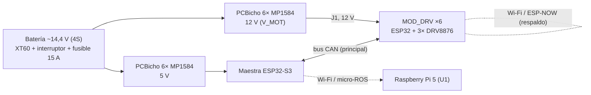

# Arquitectura electrónica de las dos unidades

> [!important] Cambios aplicados el 2026-11-09 (ver [[2026-11-08-cambios-acordados]])
> - **Unidad 1:** LiPo **3S** (11,1 V nominal), la batería roja prestada por Marco.
> - **Unidad 2:** batería de **~14,4 V (4S)**, con modelo y química por confirmar.
> - **Ya no se usa ninguna batería de 2 celdas (2S).**
> - **Unidad 2:** el **bus CAN** es el enlace principal entre las 6 patas y la maestra ESP32-S3. El Wi-Fi o ESP-NOW por pata queda como respaldo.
> - Nombre unificado del motor: **micromotor Pololu HPCB 12 V 100:1 (formato N20)**.

Diagramas en Lucidchart (un documento con cuatro pestañas): https://lucid.app/lucidchart/f26e2575-8ad8-4bb5-b2a3-36030769684d/edit
- "Unidad 1": diagrama de bloques del hexápodo primario.
- "Hardware": hardware de la Unidad 1 con fotos.
- "Hardware U2": hardware de la Unidad 2 con fotos.
- "PCB U2": distribución de la PCB única. **Esta propuesta se descartó** (ver abajo).

> [!todo] Diagramas por actualizar
> Lucidchart y las figuras TikZ (`fig_sistema`, `fig_unidad1`, `fig_unidad2`, en [[05-documentacion]] › claude-outputs) **todavía muestran 2S**. Hay que corregirlos a 3S en la U1 y ~14,4 V en la U2, y cambiar el Wi-Fi por pata por el bus CAN.

## Datos generales confirmados

- Asesor: prof. Dante Inga.
- Procesador central: **Raspberry Pi 5** a bordo de la Unidad 1, con el agente micro-ROS.
- Cámara de profundidad **Orbbec Gemini 2** en la Unidad 1, por USB 3.0.
- Comunicación **entre unidades**: Wi-Fi UDP con micro-ROS.
- Tesis en español, con la plantilla UTEC en LaTeX.

## Baterías

| Unidad | Batería | Rango de tensión | Regulación |
|---|---|---|---|
| **U1** | LiPo **3S** 3300 mAh, ≥ 25C, XT60 | 12,6 V cargada; 11,1 V nominal; ~9,9 V descargada | Buck de 6 V ≥ 15 A (servos) y buck de 5,1 V / 5 A (Raspberry Pi 5) |
| **U2** | **~14,4 V (4S)**, XT60. Química por confirmar | 4S Li-ion: 14,4 V nominal. 4S LiPo: 14,8 V nominal. En ambos casos, 16,8 V cargada | 2 placas [[Modulo de control de extremidad - Registro del proyecto\|PCBicho]] de 6× MP1584: una a 12 V (V_MOT) y otra a 5 V |

> [!question] Pregunta abierta: batería de la U2
> Falta saber el **código o modelo exacto** de la batería que se usa en la U2 (Alfredo lo confirma el 2026-11-10). Con ese dato hay que fijar:
> 1. La química: Li-ion o LiPo.
> 2. La capacidad en mAh y la tasa C.
> 3. La tensión mínima de descarga, para saber si el MP1584 mantiene los 12 V hasta el final.
>
> El MP1584 necesita ~13,5–14 V a la entrada para dar 12 V estables. Con una 4S Li-ion descargada a ~12 V (3,0 V por celda), los 12 V dejan de regularse al final de la descarga.

- **Por qué no 2S:** en la U1, una 2S cae a ~6,6 V al final de la descarga y deja sin margen al buck de 6 V. En la U2, ni la 2S ni la 3S alcanzan para regular 12 V con un buck.
- **Por qué no conectar la MOD_DRV directo a la batería de la U2:** su TVS SMAJ15A empieza a conducir a ~16,7 V. Por eso el MP1584 de 12 V va siempre entre la batería y las patas.
- Detalle de corrientes de la 3S: [[bateria-lipo-3s]].

## Unidad 1 (hexápodo de servos, primario)

- **Sin ESP32 ni PCA9685.** La Raspberry Pi 5 hace todo el control de la locomoción.
- **Driver de servos: Pololu Mini Maestro de 18 canales**, por USB desde la Raspberry Pi 5, para los 18 MG996R. Calibración en [[calibracion-tibias-hexapodo]].
- **6 finales de carrera** (contacto en la punta de cada pata), directo a GPIO de la Raspberry Pi 5.
- **IMU:** la que trae la Orbbec Gemini 2. Se descarta la BNO085 externa.
- **Gases:** MQ-9, que solo mide CO y gases combustibles (CH₄, GLP). Su salida es analógica y necesita un ADC (ADS1115 por I²C). Alcance en [[gases-a-monitorear]].
- **Alimentación (LiPo 3S 3300 mAh):** interruptor general y fusible de ~20 A a la salida de la batería; buck de 5,1 V / 5 A para la Raspberry Pi 5 (que a su vez alimenta la cámara y el Maestro por USB); buck de 6 V ≥ 15 A para los servos. Los dos buck deben admitir ≥ 13 V a la entrada.

| Carga | Potencia |
|---|---|
| Servos: 6 V × 10 A (pico) | 60 W |
| Raspberry Pi 5 + Orbbec Gemini 2 + Maestro | ~15 W |
| **Total pico** | **~75 W** |

- Corriente de batería en el pico: 75 W / (11,1 V × 0,9) ≈ **7,5 A**.
- Autonomía estimada: **~40–50 min**, con 3–4 A de consumo medio y el 80 % de la capacidad utilizable.
- Riesgo: un MG996R atascado consume ~2,5 A. Si varios se atascan a la vez se pueden llegar a 20–30 A en el lado de 6 V. Por eso se mantiene el buck de 6 V en ≥ 15 A y el fusible de ~20 A.

## Unidad 2 (hexápodo modular N20, secundario)

- **Motores:** 18 micromotores **Pololu HPCB 12 V 100:1 (formato N20)**, con ~330 RPM en vacío, 80 mA en vacío, 0,75 A de atascamiento y 1,3 kg·cm. Cada uno lleva un encoder magnético a 3,3 V.
- **Placa de pata: MOD_DRV ×6** (proyecto `Moduloa_DRV`, ya fabricada). Lleva un ESP32-WROOM-32E, 3 DRV8876 y su propia fuente (buck AP63205 de 5 V y LDO de 3,3 V) a partir de la entrada J1 de 12 V, además de un zócalo para el módulo CAN WCMCU-230. Detalle en [[Modulo de control de extremidad - Registro del proyecto]].
- **Maestra:** ESP32-S3 DevKitC-1 con transceptor CAN. Habla con la U1 por micro-ROS/Wi-Fi y controla una cámara UVC por USB.
- **Comunicación entre patas:** el **bus CAN** es el enlace principal (en cadena, con 120 Ω en los dos extremos). Como propuesta a futuro, cada pata podría seguir operando sola si pierde el CAN, usando el Wi-Fi o ESP-NOW que ya trae el ESP32, sin hardware adicional. Justificación en [[justificacion-esp32-por-pata]].
- **Soporte mecánico:** 3 niveles × 2 placas sobre la bandeja del chasis. Ver [[soporte-electronica-unidad2]].

**Presupuesto de potencia del usuario:**
- Por pata: 19,3 W (18,0 W en motores, a 0,5 A cada uno).
- Seis patas: 115,8 W.
- Maestra: ≈5,06 W.
- Total ≈121 W; 150 W como valor de diseño.

Con ~14,4 V, la corriente de batería a 150 W es ≈ 150 / (14,4 × 0,9) ≈ **11,6 A**, por debajo del fusible de 15 A.

> [!warning] Una pata con las 3 articulaciones atascadas consume ~2,4 A
> Eso supera lo que entrega un MP1584 en la práctica (~2 A). Hay que limitar la corriente con IPROPI/ITRIP del DRV8876.

> [!note]- Propuesta descartada: PCB única de la U2 (2026-10-07)
> Se propuso una placa octagonal de 26 cm que integraba las 6 secciones de pata y la maestra, con el bus CAN en cadena LR → LM → LF → maestro → RF → RM → RR. Se reemplazó por **6 MOD_DRV separadas**, que dan más modularidad y ya están fabricadas.

> [!note]- Datos de la PCB de pata v1 (`Tesis_with_3drivers`, anterior al CAN)
> - ESP32-WROOM-32E, CP2102N, USB-C, AMS1117-3.3 y 3 DRV8876 en modo PWM.
> - DRV1: IO27/IO26, IPROPI en IO32. DRV2: IO14/IO13, IPROPI en IO33. DRV3: IO18/IO19, IPROPI en IO15. Los tres nFAULT en IO4.
> - Carpeta: `02-electronica/unidad2-PCB-pata-v1/`.

## Problemas abiertos

1. **U2:** fijar la batería (modelo, química, capacidad) y comprobar que el MP1584 regula 12 V hasta el final de la descarga.
2. **U2:** CAN entre dos MOD_DRV todavía no funciona (prueba del 07-11). La MOD_DRV no tiene terminación CAN propia. Ver [[prueba-modulos-can-esp32-wcmcu230]].
3. **U2:** antena de la ESP32-S3 rodeada de cobre y motores. Alternativa: ESP32-S3-WROOM-1U con antena externa.
4. **U1:** modelo exacto del Maestro y del ADC para el MQ-9.
5. **U1:** atasco simultáneo de servos (20–30 A). Mantener el buck de 6 V en ≥ 15 A y el fusible de ~20 A.
6. Actualizar Lucidchart y las figuras TikZ (quitar la 2S y el Wi-Fi por pata).

## Notas relacionadas
- [[justificacion-esp32-por-pata]] · [[bateria-lipo-3s]] · [[Modulo de control de extremidad - Registro del proyecto]]
- [[soporte-electronica-unidad2]] · [[navegacion-unidad1-nav2-rtabmap]] · [[gases-a-monitorear]] · [[nivel-de-cooperacion]]
