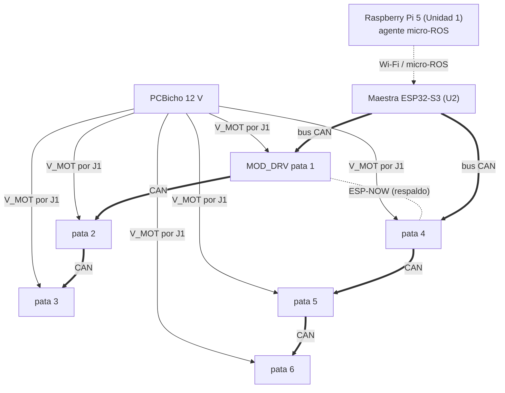

# Justificación de un ESP32 por pata

> [!important] Cambio del 2026-11-09 (ver [[2026-11-08-cambios-acordados]])
> El **enlace principal entre patas es el bus CAN** hacia la placa maestra ESP32-S3. El Wi-Fi o ESP-NOW **ya no es el enlace principal**: queda como respaldo propuesto para que una pata siga operando si pierde el bus.

> [!abstract] Idea central
> Cada pata tiene 3 micromotores Pololu HPCB 12 V 100:1 (formato N20) con encoder, y un DRV8876 por motor. Controlarla exige entre 20 y 22 señales, y el ESP32-WROOM-32E expone 26 GPIO. Una pata cabe en un ESP32 con margen; dos patas ya no caben. Por eso la unidad mínima de control es **una placa con un ESP32 por pata**, unida a las demás por un **bus CAN**.

## 1. Planteamiento

La Unidad 2 tiene 6 patas de 3 grados de libertad (coxa, fémur y tibia): 18 micromotores y 18 DRV8876. Para decidir cuántos microcontroladores usar se aplicaron tres criterios:

1. **Presupuesto de pines:** cuántas señales necesita cada motor y cuántas ofrece el microcontrolador.
2. **Periféricos disponibles:** ADC, PWM, contadores de pulsos y controlador CAN (TWAI).
3. **Cableado:** cuántos conductores cruzan el chasis y qué señales viajan entre placas.

## 2. Señales por motor

| Señal | Cantidad | Tipo | Función |
|---|---|---|---|
| IN1, IN2 | 2 | Salida PWM | Sentido y velocidad (DRV8876 en modo PWM) |
| IPROPI | 1 | Entrada analógica | Corriente del motor, 1000 µA/A |
| Encoder A, B | 2 | Entrada digital | Posición y sentido en cuadratura |
| nFAULT | 1 (compartible) | Drenador abierto | Sobrecorriente, sobretemperatura, subtensión |

## 3. Recursos del ESP32-WROOM-32E

| Recurso | Disponible | Observación |
|---|---|---|
| GPIO expuestos | 26 | GPIO6–11 los usa la flash |
| Solo entrada | 4 (34, 35, 36, 39) | Sin pull-up ni pull-down internos |
| UART0 | 2 (GPIO1, GPIO3) | Programación con el CP2102N |
| Pines de arranque | 5 (0, 2, 5, 12, 15) | Definen el modo de arranque |
| ADC1 | 6 canales | Es el único utilizable si se activa el Wi-Fi de respaldo |
| ADC2 | 10 canales | No disponible con el Wi-Fi activo |
| PWM (LEDC) | 16 canales | MCPWM añade 12 salidas |
| PCNT | 8 unidades | Una por encoder |
| **TWAI (CAN 2.0)** | 1 controlador | Solo necesita 2 pines (TX, RX) y un transceptor externo (WCMCU-230 / SN65HVD230) |

> [!tip] ADC1 sigue siendo la regla
> Aunque el enlace principal ya no es Wi-Fi, las señales IPROPI siguen en ADC1 para que el respaldo inalámbrico pueda activarse sin perder la medición de corriente.

## 4. Presupuesto de pines para una pata

| Función | Señales | Restricción |
|---|---|---|
| PWM de 3 drivers | 6 | Cualquier GPIO con salida |
| IPROPI de 3 drivers | 3 | Solo ADC1 |
| Encoders de 3 motores | 6 | Evitar los pines de arranque |
| nFAULT | 1–3 | Requiere pull-up |
| UART0 | 2 | GPIO1 y GPIO3 fijos |
| **CAN (TWAI) TX/RX** | **2** | En la MOD_DRV: IO21 (CTX) e IO22 (CRX) |
| **Total** | **20 a 22 de 26** | **Margen de 4 a 6 pines** |

## 5. Alternativas evaluadas

| Alternativa | Señales | Resultado |
|---|---|---|
| A. Un ESP32 para los 18 motores | ~90 | Inviable |
| B. Un ESP32 cada 2 patas | ~33 | Inviable: supera los 26 GPIO y agota el ADC1 |
| **C. Un ESP32 por pata + bus CAN** | 20–22 | **Viable con margen** |
| D. Un MCU central de más de 100 pines | más de 90 | Viable en pines, pero concentra 108 conductores en el chasis |

## 6. Conexiones entre placas

| Conexión | Medio | Pines del ESP32 |
|---|---|---|
| Potencia | 12 V por la bornera J1 de cada MOD_DRV | 0 |
| **Datos (principal)** | **Bus CAN** en cadena por P1/P2 (CANH, CANL, GND), con un módulo WCMCU-230 en J4 | 2 (IO21, IO22) |
| Datos (respaldo, propuesta) | Wi-Fi o ESP-NOW, con la radio integrada | 0 |
| Programación | USB-C + CP2102N | 2 (UART0) |

**Por qué CAN como enlace principal:**
- Es determinista y con arbitraje por prioridad.
- Su transmisión diferencial resiste el ruido de los motores conmutados.
- No depende del alcance de la radio dentro de un chasis metálico ni de una galería.
- Libera a la ESP32 de la pila Wi-Fi para el lazo de control.

**Por qué conservar la radio:** si se corta el bus, la pata puede seguir operando en modo degradado sin hardware adicional (propuesta a futuro, ligada a la modularidad, ver [[normas-y-reglamentos]] › ISO 22166-1).

> [!question] Pregunta abierta
> ¿El modo de respaldo por ESP-NOW entra en el alcance de la tesis o se deja solo como trabajo futuro?

## 7. Asignación de pines y correcciones

La placa v1 (`Tesis_with_3drivers`) tenía el IPROPI del DRV3 en GPIO15 (ADC2 y pin de arranque), nFAULT compartido y encoders en pines de arranque. La **MOD_DRV** vigente ya incluye CAN en IO21/IO22. La asignación completa está en [[Modulo de control de extremidad - Registro del proyecto]] (sección 4).

## 8. Medición de corriente con IPROPI

$$V_{IPROPI} = I_{motor} \cdot A_{IPROPI} \cdot R_{IPROPI}, \qquad A_{IPROPI} = 1000\ \mu A/A$$

$$I_{TRIP} = \frac{V_{REF}}{A_{IPROPI} \cdot R_{IPROPI}}$$

En la MOD_DRV, $R_{IPROPI}$ = 3 kΩ. Con 0,75 A de atascamiento: $V_{IPROPI}$ ≈ 2,25 V, dentro del rango lineal del ADC (≈0,15–2,45 V con 11 dB).

## 9. Control distribuido

- **Lazo local:** cada ESP32 cierra los lazos de corriente, velocidad y posición de sus 3 motores. Por el CAN solo viajan consignas y telemetría.
- **Modularidad:** las 6 placas son idénticas y una falla afecta a una sola pata.
- **Bioinspiración:** en los insectos cada pata tiene un control local y la marcha surge de la coordinación (Walknet, Cruse et al., 1998).

## Referencias por citar
- Espressif Systems. *ESP32-WROOM-32E Datasheet*; *ESP-IDF Programming Guide: TWAI, ADC*.
- Texas Instruments. *DRV8876* (SLVSDS7); *SN65HVD230*.
- Cruse, H. et al. (1998). Walknet. *Neural Networks*, 11(7–8), 1435–1447.
- ISO 22166-1:2021. *Robotics — Modularity for service robots — Part 1*.

## Notas relacionadas
- [[arquitectura-electronica-hexapodos]] · [[prueba-modulos-can-esp32-wcmcu230]] · [[control-motores-esp32-3x-drv8876]]
