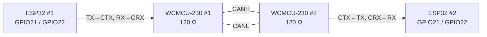

# Prueba de módulos CAN: 2× ESP32 DevKit + 2× WCMCU-230 (SN65HVD230)

## ⚙️ Especificaciones

### 1. Qué es CAN

CAN (Controller Area Network) es un bus en el que varios microcontroladores comparten solo dos cables (CANH y CANL). Por ellos se envían mensajes con identificador mediante una señal diferencial, que resiste el ruido eléctrico, y cada nodo confirma (ACK) que el mensaje llegó. En la Unidad 2 es el enlace entre el ESP32-S3 maestro y los 6 ESP32 de las patas.

- El ESP32 trae el controlador CAN integrado, llamado **TWAI** (Two-Wire Automotive Interface). Solo le falta el **transceptor** externo, que aquí es el SN65HVD230 del módulo WCMCU-230.
- **No hay direcciones de destino.** Todo mensaje llega a **todos** los nodos. El **ID de 11 bits** dice *qué es* el mensaje, y cada nodo decide si lo procesa o lo descarta.
- **Prioridad:** si dos nodos transmiten a la vez, gana el ID más bajo (arbitraje sin pérdida de datos).
- **ACK:** un mensaje necesita que **al menos otro nodo** lo confirme. Con un solo nodo en el bus la transmisión falla.

### 2. Hardware de la prueba

| Elemento | Cantidad |
|---|---|
| ESP32 DevKit (ESP32-WROOM-32) | 2 |
| Módulo WCMCU-230 (SN65HVD230, 3,3 V, con 120 Ω integrada) | 2 |
| Velocidad del bus | 500 kbit/s |

### 3. Conexiones (iguales en las dos placas)

| ESP32 DevKit | WCMCU-230 |
|---|---|
| 3V3 | 3V3 |
| GND | GND |
| GPIO21 (TX) | CTX |
| GPIO22 (RX) | CRX |

Entre los dos módulos: **CANH ↔ CANH**, **CANL ↔ CANL** y GND común.



> [!warning] Cuidados
> - **TX va con CTX y RX con CRX, sin cruzar.** El transceptor no es un UART.
> - Alimentar el módulo con **3,3 V**, no con 5 V.
> - Cada WCMCU-230 trae su resistencia de **120 Ω**. Con dos módulos quedan terminados los dos extremos y no hay que añadir más. Con todo apagado, entre CANH y CANL deben medirse **≈ 60 Ω**.
> - GPIO21 y 22 son el I²C por defecto. Funcionan para CAN mientras no se use `Wire` en el mismo programa.

### 4. Entorno: VS Code + PlatformIO

- Abrir **directamente la carpeta del proyecto**, la que contiene `platformio.ini` (File → Open Folder o PIO Home → Open Project). Si se abre una carpeta padre, PlatformIO no se activa: no aparecen los botones ✓ → 🔌 en la barra inferior y `#include <Arduino.h>` sale marcado como error.
- La terminal se abre con **Ctrl + ñ** (teclado en español), **Ctrl + `** (teclado inglés) o desde Terminal → New Terminal.
- Si la extensión ESP-IDF genera conflictos de IntelliSense, desactivarla en ese espacio de trabajo.

`platformio.ini`:

```ini
[env:esp32dev]
platform = espressif32
board = esp32dev
framework = arduino
monitor_speed = 115200
```

### 5. Código de prueba (`src/main.cpp`)

El mismo programa va en las dos placas: `NODO_EMISOR 1` en una y `0` en la otra. Esa constante solo decide qué código se compila en cada placa; no forma parte del protocolo.

```cpp
#include <Arduino.h>
#include "driver/twai.h"

#define CAN_TX GPIO_NUM_21   // ESP32 GPIO21 -> CTX del WCMCU-230
#define CAN_RX GPIO_NUM_22   // ESP32 GPIO22 -> CRX del WCMCU-230
#define NODO_EMISOR 1        // 1 = envía y recibe, 0 = solo recibe

void imprimirEstado() {
  twai_status_info_t s;
  twai_get_status_info(&s);
  const char* est[] = {"STOPPED", "RUNNING", "BUS_OFF", "RECOVERING"};
  Serial.printf("  estado=%s txErr=%lu rxErr=%lu busErr=%lu\n",
                est[s.state], s.tx_error_counter, s.rx_error_counter, s.bus_error_count);
}

void setup() {
  Serial.begin(115200);
  delay(1000);
  twai_general_config_t g = TWAI_GENERAL_CONFIG_DEFAULT(CAN_TX, CAN_RX, TWAI_MODE_NORMAL);
  twai_timing_config_t  t = TWAI_TIMING_CONFIG_500KBITS();
  twai_filter_config_t  f = TWAI_FILTER_CONFIG_ACCEPT_ALL();

  if (twai_driver_install(&g, &t, &f) != ESP_OK || twai_start() != ESP_OK) {
    Serial.println("Error iniciando TWAI");
    while (true) delay(1000);
  }
  Serial.printf("TWAI listo a 500 kbit/s (nodo %s)\n", NODO_EMISOR ? "emisor" : "receptor");
}

void loop() {
#if NODO_EMISOR
  static uint32_t n = 0;
  twai_message_t tx = {};
  tx.identifier = 0x100;
  tx.data_length_code = 4;
  memcpy(tx.data, &n, 4);
  esp_err_t r = twai_transmit(&tx, pdMS_TO_TICKS(100));
  Serial.printf("TX id=0x%03lX n=%lu -> %s\n", tx.identifier, n, esp_err_to_name(r));
  n++;
#endif

  twai_message_t rx;
  while (twai_receive(&rx, pdMS_TO_TICKS(NODO_EMISOR ? 0 : 500)) == ESP_OK) {
    Serial.printf("RX id=0x%03lX len=%d:", rx.identifier, rx.data_length_code);
    for (int i = 0; i < rx.data_length_code; i++) Serial.printf(" %02X", rx.data[i]);
    Serial.println();
  }

  imprimirEstado();
  delay(500);
}
```

Qué hace:
- El **emisor** envía cada 500 ms un contador de 4 bytes con ID `0x100`.
- El **receptor** acepta todos los IDs (`ACCEPT_ALL`) e imprime lo que llega.
- Los dos imprimen el estado del controlador y sus contadores de error.

### 6. Protocolo propuesto para la Unidad 2 (maestro + 6 patas)

Cada pata tiene un número propio (`PATA_ID` = 1..6) y los IDs se forman a partir de él:

| ID | Sentido | Contenido |
|---|---|---|
| `0x0FF` | Maestro → todas | Orden general (por ejemplo, PARO) |
| `0x100 + n` | Maestro → pata n | Consignas de los 3 motores |
| `0x200 + n` | Pata n → maestro | Telemetría: posiciones y corrientes |

Como las órdenes llevan IDs más bajos que la telemetría, tienen prioridad en el arbitraje, y el PARO (`0x0FF`) es la de mayor prioridad.

Código en cada pata (el mismo en las 6; solo cambia `PATA_ID`):

```cpp
#define PATA_ID 3   // 1..6, distinto en cada placa

void loop() {
  twai_message_t rx;
  if (twai_receive(&rx, pdMS_TO_TICKS(10)) == ESP_OK) {
    if (rx.identifier == 0x100 + PATA_ID) {
      // consigna para ESTA pata: leer rx.data y mover motores
    } else if (rx.identifier == 0x0FF) {
      // orden para todas: por ejemplo, detener motores
    }
    // cualquier otro ID se ignora
  }

  twai_message_t tx = {};
  tx.identifier = 0x200 + PATA_ID;
  tx.data_length_code = 6;
  // llenar tx.data con posiciones o corrientes
  twai_transmit(&tx, pdMS_TO_TICKS(10));
  delay(20);
}
```

El maestro (ESP32-S3) envía a `0x101…0x106` según la pata que quiera mover y lee todos los `0x2xx`.

**Filtro por hardware (opcional).** El controlador TWAI puede descartar los IDs ajenos antes de que lleguen al programa:

```cpp
twai_filter_config_t f = {
  .acceptance_code = (uint32_t)(0x100 + PATA_ID) << 21,
  .acceptance_mask = ~((uint32_t)0x7FF << 21),
  .single_filter   = true
};
```

Este filtro deja pasar solo `0x100 + PATA_ID`. Para recibir también el `0x0FF` general, usar `ACCEPT_ALL` con el `if` en software.

## 🔧 Estado

Implementado: el código y el cableado están definidos. Falta ejecutar la prueba y registrar los resultados.

## 📊 Resultados de prueba

Cómo leer la salida:

| Observación | Significado |
|---|---|
| El emisor muestra `TX ... -> ESP_OK` y el receptor `RX id=0x100` con el contador subiendo | El bus funciona |
| `txErr` sube hasta 128 o más y el estado pasa a `BUS_OFF` | Nadie da ACK: una sola placa conectada, CANH/CANL invertidos, falta la terminación o la otra placa usa otra velocidad |
| `busErr` aumenta continuamente | Ruido, cableado o tierra no común |
| `Error iniciando TWAI` | Pines mal definidos o driver ya instalado |

Prueba con una sola placa: cambiar a `TWAI_MODE_NO_ACK` y transmitir con `tx.self = 1` (autorrecepción).

Registro:

- [ ] Resistencia medida entre CANH y CANL: ___ Ω
- [x] Recepción correcta a 500 kbit/s (20/11/2026)
- [x] Mensajes perdidos en 1000 envíos: **0**
- [ ] Prueba con cable largo (≥ 1 m) o con motores encendidos cerca

### Prueba del 20/11/2026: maestra ESP32-S3 ↔ MOD_DRV

Firmware de `03-control/prueba_can/` (ESP-IDF 5.4.4, el mismo protocolo que `pata_MOD_DRV/main/can_protocol.h`). Maestra ESP32-S3 DevKitC-1 en COM4 (GPIO4 → CTX, GPIO5 ← CRX); MOD_DRV en COM6 como pata 1 (IO21/IO22). Cables cortos en banco.

| Prueba | Resultado |
|---|---|
| CRX en reposo, con el bus conectado | 1 en las dos placas |
| Autotest local (NO_ACK + autorrecepción) | 10/10 en las dos |
| Ping `0x101` → PONG `0x201` | Pasa; ida y vuelta de 716 µs en el primer ping |
| Pata → maestra, contador en `0x201` | 3/3 con ACK, recibidos en orden |
| Ráfaga de 1000 pings | **1000/1000**; ida y vuelta: mín 255 µs, prom 263 µs, máx 1656 µs |
| Errores después de la ráfaga | TEC = REC = 0, errores de bus = 0, rx perdidas = 0 |

**Contra el firmware real `pata_MOD_DRV` (paso 7, misma placa COM6):** 6/6 pings con PONG y el PARO `0x0FF` respondido con DETENIDA, con TEC = REC = 0. La ida y vuelta sube a **≈ 8,3 ms** (contra 0,26 ms del firmware de prueba): `leg_can_task` revisa la cola con `twai_receive(..., 0)` y, si no hay nada, duerme con `vTaskDelay(1)`, que con FreeRTOS a 100 Hz es un tick de 10 ms. Para bajar la latencia, conviene bloquear en `twai_receive` con timeout antes de tomar `g_motor_lock`.

**Fémur y tibia movidos por CAN (20/11/2026, misma placa COM6, V_MOT encendida):** comando `m` de la maestra (máscara 0x06, una consigna cada 50 ms, relativa al origen de `CAN,ARM`): 0 → +50 → 0 → −50 → 0 mrad. 265/265 consignas ACEPTADA, PARO final con DETENIDA. La coxa quedó fuera porque su DRVA tiene nFAULT con V_MOT encendida.

| Tramo | Fémur: ref → llegó (rad) | Tibia: ref → llegó (rad) |
|---|---|---|
| +50 mrad | 1.589 → 1.571 (18 mrad) | −0.053 → −0.074 (21 mrad) |
| 0 | 1.539 → se quedó en 1.571 (32 mrad) | −0.103 → se quedó en −0.074 (29 mrad) |
| −50 mrad | 1.489 → 1.508 (19 mrad) | −0.153 → −0.144 (9 mrad) |
| 0 | 1.539 → se quedó en 1.508 (31 mrad) | −0.103 → −0.121 (18 mrad) |

Cuando la consigna está a 50 mrad, se mueven y llegan dentro de la tolerancia (20 mrad). Al volver a 0, el error queda en 30 mrad, por debajo de 2 × tolerancia (40 mrad), así que la articulación sigue en HOLD y no corrige. Eso es del lazo de posición, no del CAN: con el límite de ±50 mrad, hacen falta pasos más grandes o una tolerancia menor para que cada paso se note.

Fallas encontradas por el camino:
- Una MOD_DRV (COM17) tenía CRX en 0 aunque el pin CRX del módulo daba 3,28 V: la unión J4 pin 4 → IO22 (pin 36 del WROOM) estaba abierta. Resoldarla funcionó, pero se volvió a abrir al mover la placa. Con esa placa conectada, todo el bus quedaba en dominante.
- El firmware de prueba tenía `pdMS_TO_TICKS(5)` = 0 con FreeRTOS a 100 Hz, lo que hacía saltar el task watchdog. Se corrigió con una espera mínima de 1 tick.

## 🔗 Relacionado

- [[control-motores-esp32-3x-drv8876]]
- [[Modulo de control de extremidad - Registro del proyecto]]
