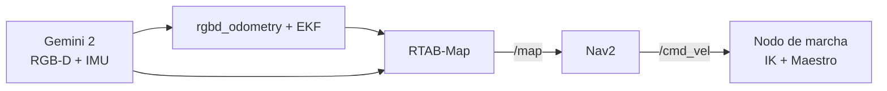

# Navegación de la Unidad 1: Nav2 + RTAB-Map

## Confirmado por el usuario
- SLAM: **RTAB-Map**.
- Navegación: **Nav2**.
- Único sensor de navegación: **Orbbec Gemini 2** (RGB-D con IMU integrada). Sin LiDAR.

## Arquitectura propuesta (por validar)
1. **Percepción** (`orbbec_camera`): color, profundidad (0,15 a 10 m, 91° × 66°) e IMU.
2. **Odometría** (`rgbd_odometry` + EKF de `robot_localization`): publica la TF `odom → base_link`. Opcional: odometría de patas.
3. **SLAM** (`rtabmap`): grafo de poses con cierre de lazo; publica `/map` y la TF `map → odom`. Tiene modo mapeo y modo localización.
4. **Planificación** (Nav2): costmaps a partir de la profundidad, planificador global, controlador local y árbol de comportamiento. Publica `/cmd_vel` (vx, vy, ωz).
5. **Locomoción** (nodo de marcha): marcha trípode, cinemática inversa, Pololu Maestro y 18 servos.

RTAB-Map reemplaza a AMCL y map_server.

## Etapas y verificación
| Etapa | Qué se hace | Cómo se verifica |
|---|---|---|
| 1. Base ROS 2 | URDF ([[urdf-pose-cero-hexapodo]]), TF, driver de la cámara, nodo de marcha con `/cmd_vel` | TF completo en RViz; el robot obedece la teleoperación |
| 2. Odometría | `rgbd_odometry` + IMU en el EKF | Deriva al cerrar un circuito (% de la distancia) |
| 3. Mapeo | RTAB-Map en modo SLAM, teleoperado | Cierres de lazo; error del mapa frente a medidas reales |
| 4. Localización + Nav2 | Costmaps, huella y límites de velocidad | Llega a las metas fijadas en RViz sin chocar |
| 5. Laboratorio | Recorridos repetidos con obstáculos | ATE, RPE, tasa de éxito, error final y uso de CPU |

## Consideraciones del hexápodo
- La oscilación del cuerpo al caminar mete ruido en la odometría visual: fusionar la IMU y usar una marcha trípode lenta.
- Marcha holonómica: usar el modelo omnidireccional en el controlador de Nav2.
- Cómputo limitado en la Raspberry Pi 5: bajar la resolución y la frecuencia de RTAB-Map, y correr RViz en una PC remota.
- Poca luz: la profundidad infrarroja funciona a oscuras, pero los rasgos RGB no. Hay que prever iluminación a bordo (relevante para socavones, ver [[problematica-y-aplicacion]]).

## Cooperación con la U2
La U1 comparte el mapa y asigna metas a la U2 (coordinación fuerte, ver [[nivel-de-cooperacion]]). Los puntos de medición de gas se georreferencian sobre el mapa de RTAB-Map (ver [[gases-a-monitorear]]).

## Pendiente
- [ ] Distribución de ROS 2 (rtabmap_ros tiene binarios para Humble, Jazzy y Rolling).
- [ ] Planificador global (NavFn o SmacPlanner2D) y controlador local (DWB, o MPPI con modelo Omni).
- [ ] Umbrales de cada verificación y referencia de verdad terreno para ATE/RPE.
- [ ] Usar la prueba ASTM E54.09 de mapeo de interiores como guía (ver [[normas-y-reglamentos]]).

> [!question] Pregunta abierta
> `03-control/robot_v7.zip` contiene `verificar_en_pi.py`. ¿Es código de la Raspberry Pi de la U1 (marcha/ROS 2)? Si lo es, conviene descomprimirlo en `04-navegacion/` o en `03-control/` como paquete.
