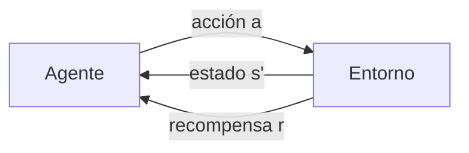

---
tags:
  - machine-learning
  - aprendizaje-por-refuerzo
  - tesis
  - memoria
  - cpp
  - python
aliases:
  - Tipos de aprendizaje
  - Machine Learning
fecha: 2026-11-05
---

# Tipos de aprendizaje automático

> [!summary] Resumen
> Existen tres paradigmas principales: **supervisado**, **no supervisado** y **por refuerzo**. Se diferencian en qué información recibe el modelo para aprender.

---

## 1. Aprendizaje supervisado

Siempre considera **entradas y salidas conocidas**: el modelo se entrena con datos de entrada y sus **etiquetas** correspondientes.

- Objetivo: aprender la relación entrada → salida.
- Ejemplos: clasificación, regresión.

---

## 2. Aprendizaje no supervisado

El modelo **descubre patrones** en datos **sin etiquetas** objetivo.

- Ejemplos: clustering, reducción de dimensionalidad.

> [!note]
> Como no hay una respuesta "correcta" de referencia, el resultado no será 100 % ideal; se evalúa con métricas indirectas.

---

## 3. Aprendizaje por refuerzo (RL)

Un **agente** aprende a tomar decisiones mediante la **interacción** con un entorno y las **recompensas** que recibe.

- La recompensa representa la **consecuencia** de una acción.
- La **experiencia** acumulada permite aprender qué acción conviene en cada situación.

### Elementos principales

| Elemento | Descripción |
|---|---|
| **Agente** | Quien aprende y toma decisiones |
| **Entorno** | El mundo con el que interactúa el agente |
| **Estado** $s$ | Situación actual del entorno |
| **Acción** $a$ | Lo que el agente decide hacer |
| **Recompensa** $r$ | Señal que indica qué tan buena fue la acción |

> [!info] Espacio de estados
> El **espacio de estados** $S$ es el conjunto de todos los estados posibles del entorno. Su tamaño (cantidad de estados) define qué tan difícil es el problema.



### Exploración vs. explotación

- **Exploración:** probar acciones nuevas para descubrir mejores opciones.
- **Explotación:** usar la mejor acción conocida hasta el momento.
- Estrategia típica: **ε-greedy** (con probabilidad ε se explora; si no, se explota).

### Retorno y factor de descuento

Las recompensas no se suman simplemente: cada una se multiplica por un **factor de descuento** $\gamma$ para obtener el **retorno**:

$$
G_t = r_t + \gamma\, r_{t+1} + \gamma^2 r_{t+2} + \dots = \sum_{k=0}^{\infty} \gamma^k r_{t+k}, \qquad 0 \le \gamma < 1
$$

> [!tip]
> Un $\gamma$ cercano a 1 hace que el agente valore el largo plazo; uno cercano a 0 lo vuelve "miope".

### Memoria de experiencias (*experience replay*)

Se guarda una memoria (*replay buffer*) con las transiciones $(s, a, r, s')$ para aprender de ellas.

- Se entrena con **muestras aleatorias** de la memoria, lo que rompe la correlación entre experiencias consecutivas y estabiliza el aprendizaje.

### ¿Cómo saber si el agente está aprendiendo?

- **Recompensa media por episodio:** debería aumentar con el entrenamiento.
- **Curva de pérdida (*loss*):** los errores indican si el agente está **estancado** o si el entrenamiento es inestable.

### Ejemplo: juegos de Atari (DQN)

Se usan **CNN** (redes neuronales convolucionales) para **caracterizar** el estado a partir de los píxeles de la pantalla.

- **DQN** (DeepMind, 2015) combinó CNN + *experience replay* + red objetivo y logró jugar juegos de Atari a nivel humano.

### Ejemplo: ajedrez

El agente aprende a tomar decisiones para **maximizar su recompensa a largo plazo**. Distingue:

| Elemento RL | En ajedrez |
|---|---|
| **Estado** | La posición actual del tablero |
| **Acción** | Una jugada |
| **Recompensa** | El resultado de la partida (ganar, empatar o perder) |

> [!note]
> La recompensa llega recién al final de la partida, por eso el agente debe valorar el largo plazo ($\gamma$ cercano a 1). Además, el espacio de estados del ajedrez es enorme (≈ $10^{43}$ posiciones), así que no se puede tabular y se usan redes neuronales.

---

## 4. Manejo de memoria: C/C++ vs. Python

> [!abstract] Idea clave
> En **C/C++** una variable **es una caja** en memoria que contiene el valor.
> En **Python** una variable **es una etiqueta** (referencia) que apunta a un objeto.

![[pizarra-memoria-c-python.png]]

### La RAM: stack y heap

| Zona | Qué guarda | Quién la libera |
|---|---|---|
| **Stack** (pila) | Variables locales y punteros | Automática, al salir de la función |
| **Heap** (montón) | Memoria dinámica (`malloc` / `new`) | C/C++: manual (`free` / `delete`). Python: *garbage collector* |

### C/C++: copia por valor

```cpp
int x = 10;   // caja x (0x27) contiene 10
int y = x;    // caja y (0x38): se COPIA el valor 10
x = 12;       // se sobrescribe la caja x
// y sigue valiendo 10 → son cajas independientes
```

### C/C++: memoria dinámica con punteros

```cpp
int *x = (int*) malloc(sizeof(int)); // x (en stack) guarda la DIRECCIÓN de un bloque en heap
*x = 10;                             // se escribe 10 en el heap (0x22)
int *y = (int*) malloc(sizeof(int)); // otro bloque independiente (0x91)
// ...
free(x); free(y);                    // liberar a mano (en C++: new / delete)
```

> [!warning]
> Si se hace `y = x;` con punteros, **ambos apuntan al mismo bloque**: cambiar `*x` cambia `*y`. Esto es lo mismo que pasa por defecto en Python.

### Python: todo es referencia

```python
x = 10    # se crea el objeto 10 (0x27); x apunta a él
y = x     # y apunta al MISMO objeto (0x27), no se copia
x = 12    # se crea un objeto nuevo 12 (0x29); x se redirige
print(y)  # 10 → y sigue apuntando a 0x27
print(id(x), id(y))  # id() muestra la "dirección" de cada objeto
```

> [!important] Inmutables vs. mutables
> - **Inmutables** (`int`, `float`, `str`, `tuple`): "modificarlos" crea un objeto nuevo, por eso `y` no cambia.
> - **Mutables** (`list`, `dict`, arrays de NumPy, tensores de PyTorch): si `y = x` y luego se modifica `x`, **`y` también cambia**.

```python
import numpy as np
a = np.zeros(3)
b = a          # misma referencia
a[0] = 5
print(b)       # [5. 0. 0.]  ← b también cambió
c = a.copy()   # copia independiente
```

### Comparación rápida

| | C/C++ | Python |
|---|---|---|
| Asignación `y = x` | Copia el valor | Copia la referencia |
| Memoria dinámica | Manual (`malloc`/`free`, `new`/`delete`) | Automática (*garbage collector*) |
| Compartir datos | Explícito (punteros, referencias `&`) | Implícito (siempre referencias) |
| Copia independiente | Por defecto | `.copy()`, `copy.deepcopy()`, `.clone()` |

### ¿Por qué importa en aprendizaje por refuerzo?

> [!danger] Error típico: replay buffer corrupto
> Si el entorno reutiliza y modifica **el mismo array** de observación, todas las transiciones guardadas apuntan al mismo objeto. El buffer termina lleno de copias del último estado y el agente parece **estancado** sin razón aparente.

```python
# ❌ Riesgoso: guarda referencias
buffer.append((obs, action, reward, next_obs, done))

# ✅ Seguro: guarda copias
buffer.append((obs.copy(), action, reward, next_obs.copy(), done))
```

> [!danger] Error típico: red objetivo (DQN)
> ```python
> target_net = policy_net          # ❌ es el MISMO objeto: la red objetivo no sirve
> target_net = copy.deepcopy(policy_net)               # ✅ copia independiente
> target_net.load_state_dict(policy_net.state_dict())  # ✅ actualizar pesos
> ```

> [!tip] Tensores en PyTorch
> Para guardar un tensor sin arrastrar el grafo ni compartir memoria: `t.detach().clone()`.

En **C++** (por ejemplo, nodos de ROS 2 o firmware del ESP32) la copia por valor es el comportamiento por defecto, pero al pasar estructuras grandes se usan referencias (`const T&`) o punteros para no copiar, y ahí vuelve a aplicar la misma precaución.

---

## Relación con la tesis

- Posible aplicación de RL en la **navegación** y la **coordinación cooperativa** de las dos unidades hexápodas.
- Ver también: [[navegacion-unidad1-nav2-rtabmap]], [[arquitectura-electronica-hexapodos]]
